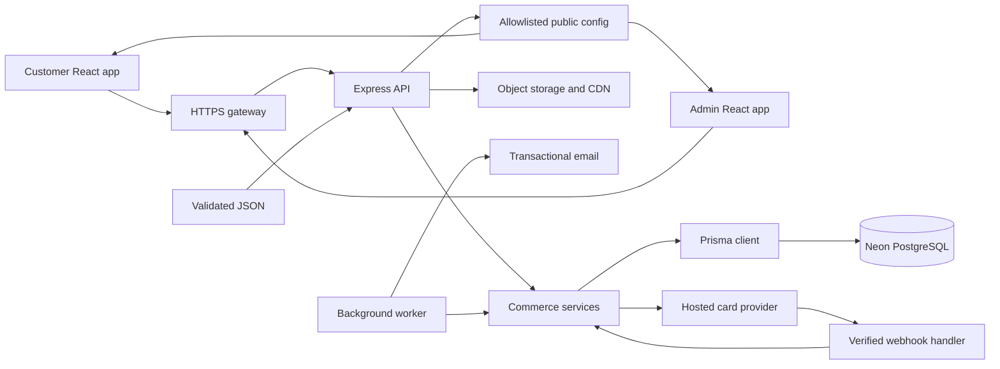

# Architecture

## System structure

Use TypeScript with two React applications and one Express service. Storefront and admin share design primitives and safe API types. Express owns validation, authorization, price calculation, stock transitions, payments and persistence. A supervised worker uses the same domain services for scheduled and retried work.



Prefer a single gateway origin with `/admin` and `/api/v1` paths. Separate origins require explicitly tested CORS, cookie and CSRF configuration. Browsers never connect directly to Neon. SPA fallbacks apply only to frontend paths; unknown API routes return JSON 404 responses.

## Proposed project structure

```text
apps/
  storefront/src/{app,pages,features,components,lib,styles}
  admin/src/{app,pages,features,components,lib,styles}
  api/
    src/{config,middleware,modules,integrations,jobs,db,generated}
    prisma/{schema.prisma,migrations,seed.ts}
    prisma.config.ts
packages/
  ui/
  contracts/
  config/
config/stores/
docs/
tests/{integration,e2e,visual}
```

This is the target full-platform structure. The Neon task has now created a small `apps/storefront` and `apps/api` connectivity scaffold, root Vite/TypeScript configuration and a root Prisma CLI configuration. Separate admin build and domain modules remain planned. Configure the future admin router basename as `/admin`.

## Frontend choices

Propose Vite, React Router, TanStack Query and schema-based forms. Pin compatible stable versions during scaffolding. Route query state includes category and filters; server query keys include market and currency. Server data owns the bag; local state owns temporary form state and open panels. Use CSS tokens and accessible primitives while matching the reference layout. Default component-library styling must not replace the reference.

Provide explicit image aspect ratios, responsive image sizes and below-fold lazy loading. Add metadata, canonical URLs and a sitemap. Decide whether React pre-rendering or SSR is required before implementing catalog SEO. A static SPA alone is not an SEO acceptance result. React documents building from scratch with tools such as Vite in its [official setup guidance](https://react.dev/learn/build-a-react-app-from-scratch).

## API and domain boundaries

Modules cover auth, accounts, catalog, inventory, cart, checkout, orders, payments, fulfillment, returns, reviews, content, analytics, media and audit. Routes validate input and pass authenticated context to services. Services own transactions; Prisma repositories own data access. Adapters isolate card, email, object storage and delivery integrations. Middleware provides request IDs, session lookup, rate limits, CSRF verification and error mapping.

Only domain services change inventory or financial status. Do not expose a generic endpoint that accepts arbitrary order status, price or user role. Write outbox events inside order transactions and deliver them afterward. Consumers handle repeat delivery. Never hold a database transaction open during provider calls or email delivery.

## Background work

Start with PostgreSQL jobs/outbox records and a supervised worker. Claim work atomically using row locks and leases; retry transient errors with bounded exponential backoff. Dead-letter exhausted jobs and surface them to operations. Jobs expire reservations, reconcile payments, retry refunds, send notifications and clean tokens. Recent dashboard orders use polling; no Redis or realtime service is needed merely to match the screenshot.

Cache public content by configuration/content revision and invalidate on publication. Shared caches must never serve another customer's authenticated response. Object storage holds image files; PostgreSQL stores metadata and object keys.

## Dependency baseline

Provisionally use Node 24 LTS, Express 5, a stable React version and Prisma 7. Verify support at scaffolding and pin exact installed versions and a lockfile. Keep Prisma CLI, client and adapter versions aligned; avoid an unpinned latest tag. The current artifacts are documentation, not installed application dependencies.

Prisma generates its backend client into an explicit directory; see the [generator reference](https://www.prisma.io/docs/orm/v7/prisma-schema/overview/generators). Use one client per API or worker process and graceful shutdown. Do not create/disconnect a client for each request. The database setup procedure appears in the operations document.

## Reuse model

Each deployed merchant has its own JSON profile and database. Two React builds keep admin navigation and dependencies separate, but API authorization remains the security boundary. A single modular Express application keeps stock and order transactions local. A shared multitenant SaaS, multiple warehouses or separate domain services requires a new architecture decision and isolation tests.
