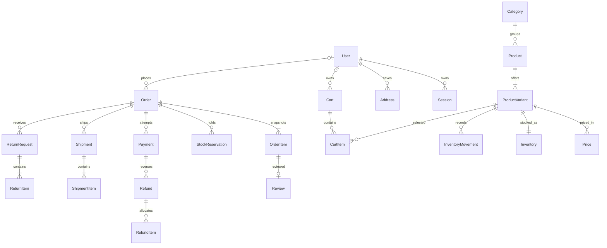

# Database and transaction design

> Current release scope: cash on delivery is active; SSLCommerz and card/webhook scenarios are deferred by the owner. Frontend and backend implementations live in `frontend/` and `backend/`. The 87-operation OpenAPI inventory and implementation/operator guides reflect current routes; card-provider sections below describe a future extension.

## Modeling rules

Use PostgreSQL foreign keys and Prisma models with UUID primary keys, UTC timestamps, explicit indexes and restricted deletion for financial history. Use BigInt minor units for stored money and serialize it as a decimal string in API responses. Currency is an ISO currency code stored on every price, quote, order, payment and refund. Currency decimal places come from the validated store profile. Never use JavaScript floating-point arithmetic for financial totals.

Maintain per-currency SKU price books. Product prices may change, but order item names, SKU codes, selected options, category, unit price, tax, discounts and delivery address are immutable snapshots. Store currency and config revision on each order. Profile changes cannot rewrite old purchases. Product copy can use translation records keyed by locale; inventory and orders remain relational data rather than configuration JSON.

## Entity dictionary

The table describes the required logical model. A complete executable `schema.prisma` and reviewed SQL migrations are implementation deliverables, not generated artifacts in this documentation stage.

| Model | Principal fields | Constraints and relationships |
| --- | --- | --- |
| User | id, normalizedEmail, passwordHash, name, role, status, emailVerifiedAt | Email unique; CUSTOMER or ADMIN; soft disable |
| Session | id, tokenHash, userId, expiresAt, revokedAt | Unique hash; optional user FK for anonymous sessions; expiry index |
| AuthToken | id, userId, tokenHash, purpose, expiresAt, usedAt | Unique hash; verification/reset/invitation |
| Address | id, userId, recipient, lines, city, region, postcode, country, phone | User FK; country validation; default per user |
| Category | id, slug, name, parentId, sortOrder, status | Unique slug; optional parent; prevent cycles |
| CategoryTranslation | categoryId, locale, name, description | Unique category and locale |
| Product | id, slug, categoryId, status, featuredRank, dimensions, version | Unique slug; DRAFT/PUBLISHED/ARCHIVED |
| ProductTranslation | productId, locale, name, description, materials, care, SEO | Unique product and locale |
| ProductVariant | id, productId, sku, optionValues, active, version | Unique SKU; options JSON validated |
| Price | id, variantId, marketId, currency, amountMinor, compareAtMinor | Unique variant/market/currency; nonnegative |
| MediaAsset | id, objectKey, mime, size, width, height, altText, status | Unique key; validated upload metadata |
| ProductImage | productId, mediaId, position, variantId | Ordered mapping; optional variant |
| Inventory | variantId, onHand, reserved, allocated, version, threshold | One balance per variant; nonnegative invariants |
| InventoryMovement | id, variantId, deltas, reason, orderId, actorId, eventKey | Append-only; eventKey unique |
| StockReservation | id, orderId, variantId, quantity, expiresAt, state | Index state/expiry; ACTIVE/CONSUMED/RELEASED |
| Cart | id, userId, guestTokenHash, marketId, currency, expiresAt, version | User or anonymous owner, not both |
| CartItem | id, cartId, variantId, quantity | Unique cart/variant; quantity greater than zero |
| Coupon | id, code, type, value, currency, limits, startsAt, endsAt, active | Unique code; fixed amount tied to currency |
| CouponRedemption | id, couponId, orderId, identityKey, state | Unique coupon/order; reserve limits atomically |
| CheckoutQuote | id, cartId, fingerprint, configRevision, currency, totals, expiresAt | Bound to cart owner and exact input |
| Order | id, number, userId, guestEmail, marketId, currency, statuses, totals, addressSnapshot, version | Unique number; immutable commercial snapshot |
| OrderItem | id, orderId, variantId, nameSnapshot, skuSnapshot, categorySnapshot, quantities, money | Quantity positive; preserve references |
| OrderEvent | id, orderId, type, actorId, metadata, createdAt | Append-only timeline; no credential payloads |
| Payment | id, orderId, provider, providerRef, method, state, amountMinor, currency | Unique provider/reference where present |
| PaymentEvent | id, provider, providerEventId, payloadHash, receivedAt, processedAt | Unique provider/event; bounded retention |
| Refund | id, orderId, paymentId, providerRef, idempotencyKey, amountMinor, state, reason | Unique scoped key and provider reference |
| RefundItem | refundId, orderItemId, quantity, merchandiseMinor, taxMinor | Item allocations; cumulative refund ceiling |
| Shipment | id, orderId, carrier, tracking, state, shippedAt, deliveredAt | One active shipment per order at launch |
| ShipmentItem | shipmentId, orderItemId, quantity | Positive quantity; cannot exceed fulfilled quantity |
| ReturnRequest | id, orderId, state, reason, requestedAt, receivedAt | Ownership and eligibility enforced |
| ReturnItem | returnId, orderItemId, quantity, condition, restockQuantity | Cannot exceed delivered unreturned quantity |
| Review | id, orderItemId, userId, rating, title, body, moderationState | One per item; rating one to five |
| ContentRevision | id, key, locale, revision, status, payload, publishedAt | Unique key/locale/revision; retain rollback |
| IdempotencyRecord | scope, keyHash, fingerprint, responseReference, expiresAt | Unique scope/key; order keys kept 30 days |
| OutboxJob | id, type, aggregateId, payload, state, attempts, availableAt, leaseUntil | Worker claim index; dedupe key |
| AuditLog | id, actorId, action, target, beforeSummary, afterSummary, requestId, createdAt | Append-only; redact personal data |

## Relationship diagram

## Inventory invariants

Available quantity equals onHand minus reserved minus allocated. All three balances are nonnegative, and reserved plus allocated cannot exceed onHand. Reserve inventory through a conditional update or locked row; do not read availability and later update without a concurrency condition. Lock multiple variants in consistent ID order and retry serialization conflicts within a bounded policy.

An unpaid card order adds to reserved. Confirmed payment moves reserved to allocated; COD confirmation does the same without collecting money. Shipment reduces onHand and allocated together. Unshipped cancellation releases reserved or allocated. A received return increases onHand only for inspected, restockable goods. Adjustments cannot remove stock promised to other orders. Every transition writes one unique movement event so retries cannot double-decrement.

Represent these checks in SQL migrations in addition to application validation; PostgreSQL [constraint documentation](https://www.postgresql.org/docs/current/ddl-constraints.html) explains database enforcement. Cross-row rules such as total refund ceilings need transactional locks or serialized updates; a simple column CHECK cannot enforce sums in another table.

## State transitions

Order business states are AWAITING_PAYMENT, CONFIRMED, PROCESSING, COMPLETED, CANCELLED and EXCEPTION. Payment states are UNPAID, PENDING, PAID, FAILED, PARTIALLY_REFUNDED and REFUNDED. Fulfillment states are UNFULFILLED, PROCESSING, SHIPPED, DELIVERED and RETURNED. Separate states prevent a shipped-but-unpaid COD order from appearing financially settled.

Card success transitions AWAITING_PAYMENT to CONFIRMED and PENDING to PAID. COD submission transitions directly to CONFIRMED with UNPAID. Confirmed orders progress through processing to completed upon delivery; COD collection is recorded independently. Cancellation before shipping is atomic with stock release. Returns and refunds append records without erasing original delivery or payment events. Ignore or reconcile out-of-order provider events; never regress PAID to FAILED because an older failure arrives late.

## Money calculations

Compute merchandise subtotal as the sum of unit price times quantity. Allocate order-level discounts deterministically across eligible lines using integer arithmetic and a largest-remainder rule, with stable line-ID ordering for ties. Compute tax per discounted line using the market's configured inclusive/exclusive mode and round half-up to minor units. Tax rates use rational or decimal arithmetic, not binary float.

Grand total equals merchandise subtotal minus discount plus shipping plus exclusive tax; inclusive tax is disclosed but not added twice. Shipping tax behavior is configured separately. Save each allocation so partial returns refund the correct discount and tax shares. The last refundable unit receives any remaining rounding residue. Refund totals cannot exceed collected payment minus confirmed or pending reserved refunds; failed refunds release their reserved ceiling. Tax policy and rates require owner-supplied launch configuration.

## Indexes retention and migrations

Index published catalog by status/category, price by market/currency/variant, orders by owner/date and status/date, payments by provider reference, jobs by state/availableAt, reservations by state/expiry, and audit by target/date. Use indexed normalized email for access checks. Search begins with PostgreSQL full-text or indexed case-insensitive queries; measure before adding a search service.

Migrations are versioned with code and tested on a disposable database branch. Use expand, backfill, deploy and contract steps for destructive shape changes. Never run reset commands on a shared or production database. Configure retention separately for sessions, webhook payloads, logs, exports and order records. Account deletion anonymizes eligible personal data while retaining required commercial records according to the chosen jurisdiction's policy; no retention period is asserted as law here.
